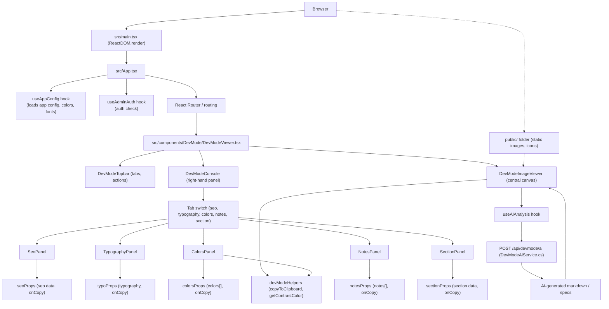

# Presentazione2 – Hub X‑Ray

## Application Flow Overview

Below is a high‑level diagram of how the application works, from loading assets to the DevMode workspace.



### Key Parts of the Flow

- **Browser → `main.tsx` → `App.tsx`** – Boots the React app.
- **`useAppConfig`** – Reads `src/types/config.ts` (colors, fonts, site data) and provides them via context.
- **`useAdminAuth`** – Performs admin‑only authentication for DevMode.
- **Routing** – Determines whether the normal presentation view or the **DevMode** UI is displayed.
- **`DevModeViewer`** – Container that houses:
  - `DevModeTopbar` – Controls actions like “Generate spec”.
  - `DevModeConsole` – Right‑hand panel with tabs for SEO, Typography, Colors, Notes, Section.
  - `DevModeImageViewer` – Central canvas that renders slides / images.
- **Panels** – Each panel receives a specific `*Props` object (e.g., `colorsProps`, `typoProps`) built in `useDevMode`. They display data and expose a copy‑to‑clipboard button.
- **`devModeHelpers`** – Utility functions (`copyToClipboard`, `getContrastColor`). `getContrastColor` decides whether the swatch text should be dark or light.
- **Image loading** – Images are served from the `public/` folder or loaded dynamically inside `DevModeImageViewer`.
- **AI analysis (`useAIAnalysis`)** – When the user clicks “Generate spec”, the hook sends the current configuration and selected section to the backend endpoint `POST /api/devmode/ai`.
- **Backend (`DevModeAiService.cs`)** – ASP.NET Core service that calls the Gemini LLM, builds markdown specifications, and returns the result.
- **Result handling** – The generated markdown is displayed in the console area and can be copied using the shared `copyToClipboard` helper.

### Quick Links to Core Files
- **Entry point** – [`src/main.tsx`](file:///Users/tecnoprogressspa/Desktop/Presentazione2/hub-xray/presentazione2/src/main.tsx)
- **Root component** – [`src/App.tsx`](file:///Users/tecnoprogressspa/Desktop/Presentazione2/hub-xray/presentazione2/src/App.tsx)
- **DevMode container** – [`src/components/DevMode/DevModeViewer.tsx`](file:///Users/tecnoprogressspa/Desktop/Presentazione2/hub-xray/presentazione2/src/components/DevMode/DevModeViewer.tsx)
- **Console / panels** – [`src/components/DevMode/DevModeConsole.tsx`](file:///Users/tecnoprogressspa/Desktop/Presentazione2/hub-xray/presentazione2/src/components/DevMode/DevModeConsole.tsx)
- **Colors panel** – [`src/components/DevMode/panels/ColorsPanel.tsx`](file:///Users/tecnoprogressspa/Desktop/Presentazione2/hub-xray/presentazione2/src/components/DevMode/panels/ColorsPanel.tsx)
- **Helpers** – [`src/components/DevMode/utils/devModeHelpers.ts`](file:///Users/tecnoprogressspa/Desktop/Presentazione2/hub-xray/presentazione2/src/components/DevMode/utils/devModeHelpers.ts)
- **AI hook** – [`src/components/DevMode/hooks/useAIAnalysis.ts`](file:///Users/tecnoprogressspa/Desktop/Presentazione2/hub-xray/presentazione2/src/components/DevMode/hooks/useAIAnalysis.ts)
- **Backend service** – [`backend/Presentazione.Api/Services/DevModeAiService.cs`](file:///Users/tecnoprogressspa/Desktop/Presentazione2/hub-xray/presentazione2/backend/Presentazione.Api/Services/DevModeAiService.cs)

---

*This diagram and description are kept up‑to‑date as of 2026‑11‑13.*
```
presentazione2
├─ README.md
├─ backend
│  ├─ Presentazione.Api
│  │  ├─ Assets
│  │  │  └─ AI
│  │  │     └─ devmode-context.md
│  │  ├─ Controllers
│  │  │  ├─ AuthController.cs
│  │  │  ├─ DevModeController.cs
│  │  │  ├─ PresentationsController.cs
│  │  │  └─ SetupController.cs
│  │  ├─ Data
│  │  │  └─ AppDbContext.cs
│  │  ├─ Dtos
│  │  │  ├─ CreatePresentationRequest.cs
│  │  │  ├─ DevModeAiRequest.cs
│  │  │  ├─ DevModeAnalysisResponse.cs
│  │  │  ├─ LoginRequest.cs
│  │  │  ├─ LoginResponse.cs
│  │  │  └─ UpdatePresentationRequest.cs
│  │  ├─ Migrations
│  │  │  ├─ 20261002135411_InitialCreate.Designer.cs
│  │  │  ├─ 20261002135411_InitialCreate.cs
│  │  │  ├─ 20261016142618_AddAdminUser.Designer.cs
│  │  │  ├─ 20261016142618_AddAdminUser.cs
│  │  │  └─ AppDbContextModelSnapshot.cs
│  │  ├─ Models
│  │  │  ├─ AdminUser.cs
│  │  │  ├─ Client.cs
│  │  │  └─ PresentationConfig.cs
│  │  ├─ Presentazione.Api.csproj
│  │  ├─ Presentazione.Api.http
│  │  ├─ Program.cs
│  │  ├─ Properties
│  │  │  └─ launchSettings.json
│  │  ├─ Prove_QueryScripts
│  │  │  ├─ Prove.sql
│  │  │  └─ insert_Client_DML.sql
│  │  ├─ Services
│  │  │  ├─ DevModeAiService.cs
│  │  │  └─ IDevModeAiService.cs
│  │  ├─ appsettings.Development.json
│  │  ├─ appsettings.json
│  │  ├─ bin
│  │  │  └─ Debug
│  │  │     └─ net10.0
│  │  │        ├─ BCrypt-Net-Next.dll
│  │  │        ├─ BuildHost-net472
│  │  │        │  ├─ Microsoft.Build.Locator.dll
│  │  │        │  ├─ Microsoft.CodeAnalysis.Workspaces.MSBuild.BuildHost.exe
│  │  │        │  ├─ Microsoft.CodeAnalysis.Workspaces.MSBuild.BuildHost.exe.config
│  │  │        │  ├─ Newtonsoft.Json.dll
│  │  │        │  ├─ System.Buffers.dll
│  │  │        │  ├─ System.Collections.Immutable.dll
│  │  │        │  ├─ System.CommandLine.dll
│  │  │        │  ├─ System.Memory.dll
│  │  │        │  ├─ System.Numerics.Vectors.dll
│  │  │        │  ├─ System.Runtime.CompilerServices.Unsafe.dll
│  │  │        │  ├─ System.Threading.Tasks.Extensions.dll
│  │  │        │  ├─ cs
│  │  │        │  │  └─ System.CommandLine.resources.dll
│  │  │        │  ├─ de
│  │  │        │  │  └─ System.CommandLine.resources.dll
│  │  │        │  ├─ es
│  │  │        │  │  └─ System.CommandLine.resources.dll
│  │  │        │  ├─ fr
│  │  │        │  │  └─ System.CommandLine.resources.dll
│  │  │        │  ├─ it
│  │  │        │  │  └─ System.CommandLine.resources.dll
│  │  │        │  ├─ ja
│  │  │        │  │  └─ System.CommandLine.resources.dll
│  │  │        │  ├─ ko
│  │  │        │  │  └─ System.CommandLine.resources.dll
│  │  │        │  ├─ pl
│  │  │        │  │  └─ System.CommandLine.resources.dll
│  │  │        │  ├─ pt-BR
│  │  │        │  │  └─ System.CommandLine.resources.dll
│  │  │        │  ├─ ru
│  │  │        │  │  └─ System.CommandLine.resources.dll
│  │  │        │  ├─ tr
│  │  │        │  │  └─ System.CommandLine.resources.dll
│  │  │        │  ├─ zh-Hans
│  │  │        │  │  └─ System.CommandLine.resources.dll
│  │  │        │  └─ zh-Hant
│  │  │        │     └─ System.CommandLine.resources.dll
│  │  │        ├─ BuildHost-netcore
│  │  │        │  ├─ Microsoft.Build.Locator.dll
│  │  │        │  ├─ Microsoft.CodeAnalysis.Workspaces.MSBuild.BuildHost.deps.json
│  │  │        │  ├─ Microsoft.CodeAnalysis.Workspaces.MSBuild.BuildHost.dll
│  │  │        │  ├─ Microsoft.CodeAnalysis.Workspaces.MSBuild.BuildHost.runtimeconfig.json
│  │  │        │  ├─ Newtonsoft.Json.dll
│  │  │        │  ├─ System.Collections.Immutable.dll
│  │  │        │  ├─ System.CommandLine.dll
│  │  │        │  ├─ cs
│  │  │        │  │  └─ System.CommandLine.resources.dll
│  │  │        │  ├─ de
│  │  │        │  │  └─ System.CommandLine.resources.dll
│  │  │        │  ├─ es
│  │  │        │  │  └─ System.CommandLine.resources.dll
│  │  │        │  ├─ fr
│  │  │        │  │  └─ System.CommandLine.resources.dll
│  │  │        │  ├─ it
│  │  │        │  │  └─ System.CommandLine.resources.dll
│  │  │        │  ├─ ja
│  │  │        │  │  └─ System.CommandLine.resources.dll
│  │  │        │  ├─ ko
│  │  │        │  │  └─ System.CommandLine.resources.dll
│  │  │        │  ├─ pl
│  │  │        │  │  └─ System.CommandLine.resources.dll
│  │  │        │  ├─ pt-BR
│  │  │        │  │  └─ System.CommandLine.resources.dll
│  │  │        │  ├─ ru
│  │  │        │  │  └─ System.CommandLine.resources.dll
│  │  │        │  ├─ tr
│  │  │        │  │  └─ System.CommandLine.resources.dll
│  │  │        │  ├─ zh-Hans
│  │  │        │  │  └─ System.CommandLine.resources.dll
│  │  │        │  └─ zh-Hant
│  │  │        │     └─ System.CommandLine.resources.dll
│  │  │        ├─ Humanizer.dll
│  │  │        ├─ Microsoft.AspNetCore.Authentication.JwtBearer.dll
│  │  │        ├─ Microsoft.AspNetCore.OpenApi.dll
│  │  │        ├─ Microsoft.Bcl.Cryptography.dll
│  │  │        ├─ Microsoft.Build.Framework.dll
│  │  │        ├─ Microsoft.CodeAnalysis.CSharp.Workspaces.dll
│  │  │        ├─ Microsoft.CodeAnalysis.CSharp.dll
│  │  │        ├─ Microsoft.CodeAnalysis.ExternalAccess.RazorCompiler.dll
│  │  │        ├─ Microsoft.CodeAnalysis.Workspaces.MSBuild.dll
│  │  │        ├─ Microsoft.CodeAnalysis.Workspaces.dll
│  │  │        ├─ Microsoft.CodeAnalysis.dll
│  │  │        ├─ Microsoft.Data.Sqlite.dll
│  │  │        ├─ Microsoft.EntityFrameworkCore.Abstractions.dll
│  │  │        ├─ Microsoft.EntityFrameworkCore.Design.dll
│  │  │        ├─ Microsoft.EntityFrameworkCore.Relational.dll
│  │  │        ├─ Microsoft.EntityFrameworkCore.Sqlite.dll
│  │  │        ├─ Microsoft.EntityFrameworkCore.dll
│  │  │        ├─ Microsoft.Extensions.DependencyModel.dll
│  │  │        ├─ Microsoft.IdentityModel.Abstractions.dll
│  │  │        ├─ Microsoft.IdentityModel.JsonWebTokens.dll
│  │  │        ├─ Microsoft.IdentityModel.Logging.dll
│  │  │        ├─ Microsoft.IdentityModel.Protocols.OpenIdConnect.dll
│  │  │        ├─ Microsoft.IdentityModel.Protocols.dll
│  │  │        ├─ Microsoft.IdentityModel.Tokens.dll
│  │  │        ├─ Microsoft.OpenApi.dll
│  │  │        ├─ Microsoft.VisualStudio.SolutionPersistence.dll
│  │  │        ├─ Mono.TextTemplating.dll
│  │  │        ├─ Newtonsoft.Json.dll
│  │  │        ├─ Presentazione.Api
│  │  │        ├─ Presentazione.Api.deps.json
│  │  │        ├─ Presentazione.Api.dll
│  │  │        ├─ Presentazione.Api.pdb
│  │  │        ├─ Presentazione.Api.runtimeconfig.json
│  │  │        ├─ Presentazione.Api.staticwebassets.endpoints.json
│  │  │        ├─ Presentazione.Api.staticwebassets.runtime.json
│  │  │        ├─ SQLitePCLRaw.batteries_v2.dll
│  │  │        ├─ SQLitePCLRaw.core.dll
│  │  │        ├─ SQLitePCLRaw.provider.e_sqlite3.dll
│  │  │        ├─ System.CodeDom.dll
│  │  │        ├─ System.Composition.AttributedModel.dll
│  │  │        ├─ System.Composition.Convention.dll
│  │  │        ├─ System.Composition.Hosting.dll
│  │  │        ├─ System.Composition.Runtime.dll
│  │  │        ├─ System.Composition.TypedParts.dll
│  │  │        ├─ System.IdentityModel.Tokens.Jwt.dll
│  │  │        ├─ appsettings.Development.json
│  │  │        ├─ appsettings.json
│  │  │        ├─ cs
│  │  │        │  ├─ Microsoft.CodeAnalysis.CSharp.Workspaces.resources.dll
│  │  │        │  ├─ Microsoft.CodeAnalysis.CSharp.resources.dll
│  │  │        │  ├─ Microsoft.CodeAnalysis.Workspaces.MSBuild.resources.dll
│  │  │        │  ├─ Microsoft.CodeAnalysis.Workspaces.resources.dll
│  │  │        │  └─ Microsoft.CodeAnalysis.resources.dll
│  │  │        ├─ de
│  │  │        │  ├─ Microsoft.CodeAnalysis.CSharp.Workspaces.resources.dll
│  │  │        │  ├─ Microsoft.CodeAnalysis.CSharp.resources.dll
│  │  │        │  ├─ Microsoft.CodeAnalysis.Workspaces.MSBuild.resources.dll
│  │  │        │  ├─ Microsoft.CodeAnalysis.Workspaces.resources.dll
│  │  │        │  └─ Microsoft.CodeAnalysis.resources.dll
│  │  │        ├─ es
│  │  │        │  ├─ Microsoft.CodeAnalysis.CSharp.Workspaces.resources.dll
│  │  │        │  ├─ Microsoft.CodeAnalysis.CSharp.resources.dll
│  │  │        │  ├─ Microsoft.CodeAnalysis.Workspaces.MSBuild.resources.dll
│  │  │        │  ├─ Microsoft.CodeAnalysis.Workspaces.resources.dll
│  │  │        │  └─ Microsoft.CodeAnalysis.resources.dll
│  │  │        ├─ fr
│  │  │        │  ├─ Microsoft.CodeAnalysis.CSharp.Workspaces.resources.dll
│  │  │        │  ├─ Microsoft.CodeAnalysis.CSharp.resources.dll
│  │  │        │  ├─ Microsoft.CodeAnalysis.Workspaces.MSBuild.resources.dll
│  │  │        │  ├─ Microsoft.CodeAnalysis.Workspaces.resources.dll
│  │  │        │  └─ Microsoft.CodeAnalysis.resources.dll
│  │  │        ├─ it
│  │  │        │  ├─ Microsoft.CodeAnalysis.CSharp.Workspaces.resources.dll
│  │  │        │  ├─ Microsoft.CodeAnalysis.CSharp.resources.dll
│  │  │        │  ├─ Microsoft.CodeAnalysis.Workspaces.MSBuild.resources.dll
│  │  │        │  ├─ Microsoft.CodeAnalysis.Workspaces.resources.dll
│  │  │        │  └─ Microsoft.CodeAnalysis.resources.dll
│  │  │        ├─ ja
│  │  │        │  ├─ Microsoft.CodeAnalysis.CSharp.Workspaces.resources.dll
│  │  │        │  ├─ Microsoft.CodeAnalysis.CSharp.resources.dll
│  │  │        │  ├─ Microsoft.CodeAnalysis.Workspaces.MSBuild.resources.dll
│  │  │        │  ├─ Microsoft.CodeAnalysis.Workspaces.resources.dll
│  │  │        │  └─ Microsoft.CodeAnalysis.resources.dll
│  │  │        ├─ ko
│  │  │        │  ├─ Microsoft.CodeAnalysis.CSharp.Workspaces.resources.dll
│  │  │        │  ├─ Microsoft.CodeAnalysis.CSharp.resources.dll
│  │  │        │  ├─ Microsoft.CodeAnalysis.Workspaces.MSBuild.resources.dll
│  │  │        │  ├─ Microsoft.CodeAnalysis.Workspaces.resources.dll
│  │  │        │  └─ Microsoft.CodeAnalysis.resources.dll
│  │  │        ├─ pl
│  │  │        │  ├─ Microsoft.CodeAnalysis.CSharp.Workspaces.resources.dll
│  │  │        │  ├─ Microsoft.CodeAnalysis.CSharp.resources.dll
│  │  │        │  ├─ Microsoft.CodeAnalysis.Workspaces.MSBuild.resources.dll
│  │  │        │  ├─ Microsoft.CodeAnalysis.Workspaces.resources.dll
│  │  │        │  └─ Microsoft.CodeAnalysis.resources.dll
│  │  │        ├─ pt-BR
│  │  │        │  ├─ Microsoft.CodeAnalysis.CSharp.Workspaces.resources.dll
│  │  │        │  ├─ Microsoft.CodeAnalysis.CSharp.resources.dll
│  │  │        │  ├─ Microsoft.CodeAnalysis.Workspaces.MSBuild.resources.dll
│  │  │        │  ├─ Microsoft.CodeAnalysis.Workspaces.resources.dll
│  │  │        │  └─ Microsoft.CodeAnalysis.resources.dll
│  │  │        ├─ ru
│  │  │        │  ├─ Microsoft.CodeAnalysis.CSharp.Workspaces.resources.dll
│  │  │        │  ├─ Microsoft.CodeAnalysis.CSharp.resources.dll
│  │  │        │  ├─ Microsoft.CodeAnalysis.Workspaces.MSBuild.resources.dll
│  │  │        │  ├─ Microsoft.CodeAnalysis.Workspaces.resources.dll
│  │  │        │  └─ Microsoft.CodeAnalysis.resources.dll
│  │  │        ├─ runtimes
│  │  │        │  ├─ browser-wasm
│  │  │        │  │  └─ nativeassets
│  │  │        │  │     └─ net9.0
│  │  │        │  │        └─ e_sqlite3.a
│  │  │        │  ├─ linux-arm
│  │  │        │  │  └─ native
│  │  │        │  │     └─ libe_sqlite3.so
│  │  │        │  ├─ linux-arm64
│  │  │        │  │  └─ native
│  │  │        │  │     └─ libe_sqlite3.so
│  │  │        │  ├─ linux-armel
│  │  │        │  │  └─ native
│  │  │        │  │     └─ libe_sqlite3.so
│  │  │        │  ├─ linux-mips64
│  │  │        │  │  └─ native
│  │  │        │  │     └─ libe_sqlite3.so
│  │  │        │  ├─ linux-musl-arm
│  │  │        │  │  └─ native
│  │  │        │  │     └─ libe_sqlite3.so
│  │  │        │  ├─ linux-musl-arm64
│  │  │        │  │  └─ native
│  │  │        │  │     └─ libe_sqlite3.so
│  │  │        │  ├─ linux-musl-riscv64
│  │  │        │  │  └─ native
│  │  │        │  │     └─ libe_sqlite3.so
│  │  │        │  ├─ linux-musl-s390x
│  │  │        │  │  └─ native
│  │  │        │  │     └─ libe_sqlite3.so
│  │  │        │  ├─ linux-musl-x64
│  │  │        │  │  └─ native
│  │  │        │  │     └─ libe_sqlite3.so
│  │  │        │  ├─ linux-ppc64le
│  │  │        │  │  └─ native
│  │  │        │  │     └─ libe_sqlite3.so
│  │  │        │  ├─ linux-riscv64
│  │  │        │  │  └─ native
│  │  │        │  │     └─ libe_sqlite3.so
│  │  │        │  ├─ linux-s390x
│  │  │        │  │  └─ native
│  │  │        │  │     └─ libe_sqlite3.so
│  │  │        │  ├─ linux-x64
│  │  │        │  │  └─ native
│  │  │        │  │     └─ libe_sqlite3.so
│  │  │        │  ├─ linux-x86
│  │  │        │  │  └─ native
│  │  │        │  │     └─ libe_sqlite3.so
│  │  │        │  ├─ maccatalyst-arm64
│  │  │        │  │  └─ native
│  │  │        │  │     └─ libe_sqlite3.dylib
│  │  │        │  ├─ maccatalyst-x64
│  │  │        │  │  └─ native
│  │  │        │  │     └─ libe_sqlite3.dylib
│  │  │        │  ├─ osx-arm64
│  │  │        │  │  └─ native
│  │  │        │  │     └─ libe_sqlite3.dylib
│  │  │        │  ├─ osx-x64
│  │  │        │  │  └─ native
│  │  │        │  │     └─ libe_sqlite3.dylib
│  │  │        │  ├─ win-arm64
│  │  │        │  │  └─ native
│  │  │        │  │     └─ e_sqlite3.dll
│  │  │        │  ├─ win-x64
│  │  │        │  │  └─ native
│  │  │        │  │     └─ e_sqlite3.dll
│  │  │        │  └─ win-x86
│  │  │        │     └─ native
│  │  │        │        └─ e_sqlite3.dll
│  │  │        ├─ tr
│  │  │        │  ├─ Microsoft.CodeAnalysis.CSharp.Workspaces.resources.dll
│  │  │        │  ├─ Microsoft.CodeAnalysis.CSharp.resources.dll
│  │  │        │  ├─ Microsoft.CodeAnalysis.Workspaces.MSBuild.resources.dll
│  │  │        │  ├─ Microsoft.CodeAnalysis.Workspaces.resources.dll
│  │  │        │  └─ Microsoft.CodeAnalysis.resources.dll
│  │  │        ├─ zh-Hans
│  │  │        │  ├─ Microsoft.CodeAnalysis.CSharp.Workspaces.resources.dll
│  │  │        │  ├─ Microsoft.CodeAnalysis.CSharp.resources.dll
│  │  │        │  ├─ Microsoft.CodeAnalysis.Workspaces.MSBuild.resources.dll
│  │  │        │  ├─ Microsoft.CodeAnalysis.Workspaces.resources.dll
│  │  │        │  └─ Microsoft.CodeAnalysis.resources.dll
│  │  │        └─ zh-Hant
│  │  │           ├─ Microsoft.CodeAnalysis.CSharp.Workspaces.resources.dll
│  │  │           ├─ Microsoft.CodeAnalysis.CSharp.resources.dll
│  │  │           ├─ Microsoft.CodeAnalysis.Workspaces.MSBuild.resources.dll
│  │  │           ├─ Microsoft.CodeAnalysis.Workspaces.resources.dll
│  │  │           └─ Microsoft.CodeAnalysis.resources.dll
│  │  ├─ elencoClient.db
│  │  ├─ obj
│  │  │  ├─ Debug
│  │  │  │  └─ net10.0
│  │  │  │     ├─ .NETCoreApp,Version=v10.0.AssemblyAttributes.cs
│  │  │  │     ├─ Presenta.0197E071.Up2Date
│  │  │  │     ├─ Presentazione.Api.AssemblyInfo.cs
│  │  │  │     ├─ Presentazione.Api.AssemblyInfoInputs.cache
│  │  │  │     ├─ Presentazione.Api.GeneratedMSBuildEditorConfig.editorconfig
│  │  │  │     ├─ Presentazione.Api.GlobalUsings.g.cs
│  │  │  │     ├─ Presentazione.Api.MvcApplicationPartsAssemblyInfo.cache
│  │  │  │     ├─ Presentazione.Api.MvcApplicationPartsAssemblyInfo.cs
│  │  │  │     ├─ Presentazione.Api.assets.cache
│  │  │  │     ├─ Presentazione.Api.csproj.AssemblyReference.cache
│  │  │  │     ├─ Presentazione.Api.csproj.CoreCompileInputs.cache
│  │  │  │     ├─ Presentazione.Api.csproj.FileListAbsolute.txt
│  │  │  │     ├─ Presentazione.Api.dll
│  │  │  │     ├─ Presentazione.Api.genruntimeconfig.cache
│  │  │  │     ├─ Presentazione.Api.pdb
│  │  │  │     ├─ Presentazione.Api.sourcelink.json
│  │  │  │     ├─ apphost
│  │  │  │     ├─ ref
│  │  │  │     │  └─ Presentazione.Api.dll
│  │  │  │     ├─ refint
│  │  │  │     │  └─ Presentazione.Api.dll
│  │  │  │     ├─ rjsmcshtml.dswa.cache.json
│  │  │  │     ├─ rjsmrazor.dswa.cache.json
│  │  │  │     ├─ rpswa.dswa.cache.json
│  │  │  │     ├─ staticwebassets
│  │  │  │     ├─ staticwebassets.build.endpoints.json
│  │  │  │     ├─ staticwebassets.build.json
│  │  │  │     ├─ staticwebassets.build.json.cache
│  │  │  │     ├─ staticwebassets.development.json
│  │  │  │     └─ swae.build.ex.cache
│  │  │  ├─ Presentazione.Api.csproj.nuget.dgspec.json
│  │  │  ├─ Presentazione.Api.csproj.nuget.g.props
│  │  │  ├─ Presentazione.Api.csproj.nuget.g.targets
│  │  │  ├─ project.assets.json
│  │  │  └─ project.nuget.cache
│  │  ├─ presentationhub.db
│  │  └─ wwwroot
│  └─ README.md
├─ docs
│  ├─ PRESENTAZIONE.md
│  ├─ README.md
│  └─ REPORT_PRESTAZIONI_E_FLUSSI.md
├─ eslint.config.js
├─ index.html
├─ netlify.toml
├─ package-lock.json
├─ package.json
├─ public
│  ├─ Gilroy-ExtraBold.otf
│  ├─ Gilroy-Light.otf
│  ├─ _redirects
│  ├─ config.json
│  ├─ favicon.svg
│  ├─ icons.svg
│  ├─ presentazione.pdf
│  ├─ robots.txt
│  └─ web.config
├─ server
│  └─ package.json
├─ src
│  ├─ App.tsx
│  ├─ assets
│  │  ├─ logo-tp-black.svg
│  │  └─ tp_logo.png
│  ├─ clientLink
│  │  ├─ index.ts
│  │  ├─ shareLinkGenerator.tsx
│  │  └─ useClientLik.ts
│  ├─ components
│  │  ├─ ConfigPan
│  │  │  └─ ConfigPanel.tsx
│  │  ├─ DevMode
│  │  │  ├─ DevModeConsole.tsx
│  │  │  ├─ DevModeImageViewer.tsx
│  │  │  ├─ DevModeTopbar.tsx
│  │  │  ├─ DevModeViewer.scss
│  │  │  ├─ DevModeViewer.tsx
│  │  │  ├─ hooks
│  │  │  │  ├─ useAIAnalysis.ts
│  │  │  │  └─ useDevMode.ts
│  │  │  ├─ panels
│  │  │  │  ├─ ColorsPanel.tsx
│  │  │  │  ├─ NotesPanel.tsx
│  │  │  │  ├─ SectionPanel.tsx
│  │  │  │  ├─ SeoPanel.tsx
│  │  │  │  └─ TypographyPanel.tsx
│  │  │  └─ utils
│  │  │     └─ devModeHelpers.ts
│  │  ├─ DevModeViewer.min.css
│  │  ├─ DevModeViewer.min.css.map
│  │  ├─ Floating
│  │  │  ├─ CreditCanvasCard.tsx
│  │  │  ├─ CustomFloatingCard.tsx
│  │  │  ├─ FloatingCard.tsx
│  │  │  └─ InfoPopupCard.tsx
│  │  ├─ HUD
│  │  │  ├─ FooterHUD.tsx
│  │  │  └─ HeaderHUD.tsx
│  │  ├─ Login
│  │  │  └─ AdminLoginGate.tsx
│  │  └─ Presentation
│  │     ├─ DraftImage.tsx
│  │     └─ PresentationViewer.tsx
│  ├─ global.min.css
│  ├─ global.min.css.map
│  ├─ hooks
│  │  ├─ use3DTilt.ts
│  │  ├─ useAdminAuth.ts
│  │  ├─ useAppConfig.ts
│  │  ├─ useAppRouting.ts
│  │  └─ useDraftPrefetch.ts
│  ├─ main.tsx
│  ├─ styles
│  │  ├─ _mixins.scss
│  │  ├─ _reset.scss
│  │  ├─ _variabiles.scss
│  │  ├─ components
│  │  │  ├─ CreditCanvasCard.min.css
│  │  │  ├─ CreditCanvasCard.min.css.map
│  │  │  ├─ CustomFloatingCard.min.css
│  │  │  ├─ CustomFloatingCard.min.css.map
│  │  │  ├─ FloatingCard.min.css
│  │  │  ├─ FloatingCard.min.css.map
│  │  │  ├─ FooterHUD.min.css
│  │  │  ├─ FooterHUD.min.css.map
│  │  │  ├─ InfoPopupCard.min.css
│  │  │  ├─ InfoPopupCard.min.css.map
│  │  │  ├─ PresentationViewer.min.css
│  │  │  ├─ PresentationViewer.min.css.map
│  │  │  ├─ floating
│  │  │  │  ├─ CreditCanvasCard.scss
│  │  │  │  ├─ CustomFloatingCard.scss
│  │  │  │  ├─ FloatingCard.scss
│  │  │  │  └─ InfoPopupCard.scss
│  │  │  ├─ hud
│  │  │  │  └─ FooterHUD.scss
│  │  │  └─ presentation
│  │  │     └─ PresentationViewer.scss
│  │  ├─ generated
│  │  │  ├─ CreditCanvasCard.min.css
│  │  │  ├─ CreditCanvasCard.min.css.map
│  │  │  ├─ CustomFloatingCard.min.css
│  │  │  ├─ CustomFloatingCard.min.css.map
│  │  │  ├─ FloatingCard.min.css
│  │  │  ├─ FloatingCard.min.css.map
│  │  │  ├─ FooterHUD.min.css
│  │  │  ├─ FooterHUD.min.css.map
│  │  │  ├─ InfoPopupCard.min.css
│  │  │  ├─ InfoPopupCard.min.css.map
│  │  │  ├─ PresentationViewer.min.css
│  │  │  ├─ PresentationViewer.min.css.map
│  │  │  ├─ global.min.css
│  │  │  └─ global.min.css.map
│  │  └─ global.scss
│  └─ types
│     └─ config.ts
├─ tsconfig.app.json
├─ tsconfig.json
├─ tsconfig.node.json
├─ vercel.json
└─ vite.config.ts

```