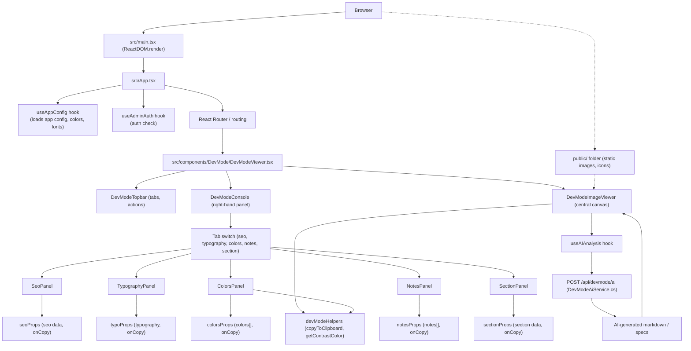

# Presentazione2 – Hub X‑Ray

## Application Flow Overview

Below is a high‑level diagram of how the application works, from loading assets to the DevMode workspace.

### Key Parts of the Flow

- **Browser → `main.tsx` → `App.tsx`** – Boots the React app.
- **`useAppConfig`** – Reads `src/types/config.ts` (colors, fonts, site data) and provides them via context.
- **`useAdminAuth`** – Performs admin‑only authentication for DevMode.
- **Routing** – Determines whether the normal presentation view or the **DevMode** UI is displayed.
- **`DevModeViewer`** – Container that houses:
  - `DevModeTopbar` – Controls actions like “Generate spec”.
  - `DevModeConsole` – Right‑hand panel with tabs for SEO, Typography, Colors, Notes, Section.
  - `DevModeImageViewer` – Central canvas that renders slides / images.
- **Panels** – Each panel receives a specific `*Props` object (e.g., `colorsProps`, `typoProps`) built in `useDevMode`. They display data and expose a copy‑to‑clipboard button.
- **`devModeHelpers`** – Utility functions (`copyToClipboard`, `getContrastColor`). `getContrastColor` decides whether the swatch text should be dark or light.
- **Image loading** – Images are served from the `public/` folder or loaded dynamically inside `DevModeImageViewer`.
- **AI analysis (`useAIAnalysis`)** – When the user clicks “Generate spec”, the hook sends the current configuration and selected section to the backend endpoint `POST /api/devmode/ai`.
- **Backend (`DevModeAiService.cs`)** – ASP.NET Core service that calls the Gemini LLM, builds markdown specifications, and returns the result.
- **Result handling** – The generated markdown is displayed in the console area and can be copied using the shared `copyToClipboard` helper.

### Quick Links to Core Files
- **Entry point** – [`src/main.tsx`](file:///Users/tecnoprogressspa/Desktop/Presentazione2/hub-xray/presentazione2/src/main.tsx)
- **Root component** – [`src/App.tsx`](file:///Users/tecnoprogressspa/Desktop/Presentazione2/hub-xray/presentazione2/src/App.tsx)
- **DevMode container** – [`src/components/DevMode/DevModeViewer.tsx`](file:///Users/tecnoprogressspa/Desktop/Presentazione2/hub-xray/presentazione2/src/components/DevMode/DevModeViewer.tsx)
- **Console / panels** – [`src/components/DevMode/DevModeConsole.tsx`](file:///Users/tecnoprogressspa/Desktop/Presentazione2/hub-xray/presentazione2/src/components/DevMode/DevModeConsole.tsx)
- **Colors panel** – [`src/components/DevMode/panels/ColorsPanel.tsx`](file:///Users/tecnoprogressspa/Desktop/Presentazione2/hub-xray/presentazione2/src/components/DevMode/panels/ColorsPanel.tsx)
- **Helpers** – [`src/components/DevMode/utils/devModeHelpers.ts`](file:///Users/tecnoprogressspa/Desktop/Presentazione2/hub-xray/presentazione2/src/components/DevMode/utils/devModeHelpers.ts)
- **AI hook** – [`src/components/DevMode/hooks/useAIAnalysis.ts`](file:///Users/tecnoprogressspa/Desktop/Presentazione2/hub-xray/presentazione2/src/components/DevMode/hooks/useAIAnalysis.ts)
- **Backend service** – [`backend/Presentazione.Api/Services/DevModeAiService.cs`](file:///Users/tecnoprogressspa/Desktop/Presentazione2/hub-xray/presentazione2/backend/Presentazione.Api/Services/DevModeAiService.cs)

---

*This diagram and description are kept up‑to‑date as of 2026‑11‑13.*